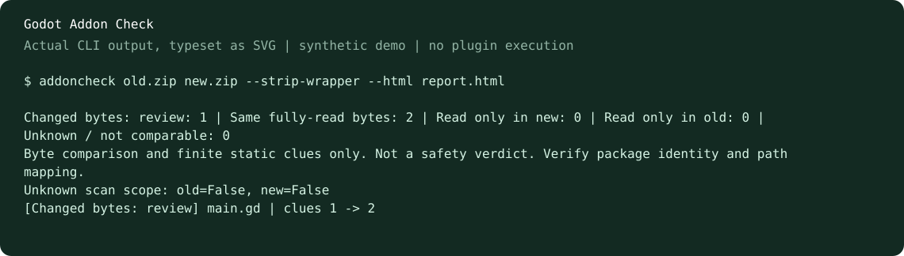

# Godot Addon Check

**Two versions of a Godot add-on ZIP? Compare them without unpacking or running the plugin.**

Review changed file bytes, finite static API clues, and explicitly unknown scope. Free, local, MIT-licensed. **Alpha preview, not a safety scanner or a complete diff.**



## Try it

### Windows x64, without installing Python

Download the portable ZIP from Releases, unpack the tool, then run in PowerShell:

```powershell
.\addoncheck\addoncheck.cmd old.zip new.zip --strip-wrapper --html upgrade.html
```

This is a CLI bundle, not a GUI installer. Keep its `runtime/` and `addoncheck/` folders beside `addoncheck.cmd`. It includes the official Python 3.13.16 embeddable runtime, pinned to the SHA-256 published by Python.org; the runtime license is included. No Python installation is required, and the plugin ZIPs being checked are not unpacked.

### Python / pipx

Download the wheel from [Releases](https://github.com/BobbyJia-shuai/godot-addon-check/releases), then:

```sh
python -m pip install ./godot_addon_check-0.4.1a1-py3-none-any.whl
addoncheck old.zip new.zip --strip-wrapper --html upgrade.html
```

Python 3.10+ required. No runtime packages or API key needed. You can also use `pipx install ./godot_addon_check-0.4.1a1-py3-none-any.whl` if pipx is already installed. This project has not been published to PyPI; do not assume a similarly named package is ours.

From a source checkout:

```sh
python -m addoncheck examples/old.zip examples/new.zip --strip-wrapper --html report.html
python -m addoncheck.desktop       # optional Chinese-language desktop GUI, requires Tkinter
```

The synthetic examples are original, benign test fixtures. The tool never activates them. For GitHub source ZIPs, explicitly select `--strip-wrapper` to align the unique outer directory. Verify both inputs belong to the same add-on and inspect the path mapping.

## Why this instead of Git?

Use Git if you already have a repository and prefer its full diff/history. This tool focuses on the narrower case of **two third-party ZIPs**, a local report and a conservative review checklist. We have not proven it saves developer time. Looking for five Godot developers willing to compare it with their usual workflow.

## CLI and CI

```sh
addoncheck old.zip new.zip --strip-wrapper --json result.json --html result.html --fail-on-change
```

| Exit | Meaning |
| --- | --- |
| 0 | Report generated without known scan gaps; not a safety verdict |
| 1 | File bytes differ and `--fail-on-change` was requested |
| 2 | Input, path mapping, or export failed |
| 3 | Report generated, but at least one side has uninspected content; takes priority over 1 |

Default terminal and HTML are English; `--lang zh` selects Chinese. JSON uses stable rule/status codes, with some human explanations in Chinese. The optional Tk GUI is currently Chinese.

Exports hide source and diff text by default. Use `--include-source` only when appropriate; paths, filenames, line numbers and hashes remain visible either way.

## What it actually checks

- Complete file byte hashes; all byte changes stay visible, including comments/line endings and zero-clue files.
- Finite lexical GDScript/C# cues for process, network, file write and editor tooling APIs.
- Configuration entry paths, native/unread content and archive anomalies.
- Bounded UTF-8 diff previews from the exact scan-time bytes, with explicit truncation/omission.

It does **not** establish plugin identity, malware absence, semantic equivalence, version compatibility, or risk reduction. Dynamic calls, full C# expression analysis, native code and dataflow are outside scope. Source ZIPs may omit release binaries/submodules. A missing file on an incomplete side is unknown, never called deleted.

Default limits: 2,000 files, 1 MiB/file, 32 MiB read content, 64 MiB ZIP input, 20,000 ZIP directory entries, 500 findings. ZIP64/multipart ZIPs are refused. Previews: 64 KiB and 2,000 lines per side; 150 lines/16,000 characters per preview; 100 files/512 KiB input per comparison. Default exclusions apply. Directories are not atomic snapshots or an isolation boundary against hostile concurrent changes.

## Evidence and feedback

See [validation](docs/VALIDATION.md), [contributing](CONTRIBUTING.md), and [release notes](CHANGELOG.md). Tests are developer-run checks, not evidence of user adoption or independent security auditing.

Useful feedback: which ZIP upgrade you tried, whether you found a meaningful change, where the result was unclear, and whether you would use it again. Please use [Issues](https://github.com/BobbyJia-shuai/godot-addon-check/issues); do not upload secrets, private code, or suspected malware. No star request is required to try the tool.

## Develop

```sh
python -m unittest discover -s tests -v
python -m pip install build
python -m build --wheel
```

Tk tests need a desktop session. The CLI does not import Tk. No third-party research source archives or private discussion transcripts are distributed in this repository. MIT covers this project's code; any separately distributed runtime retains its own license.
